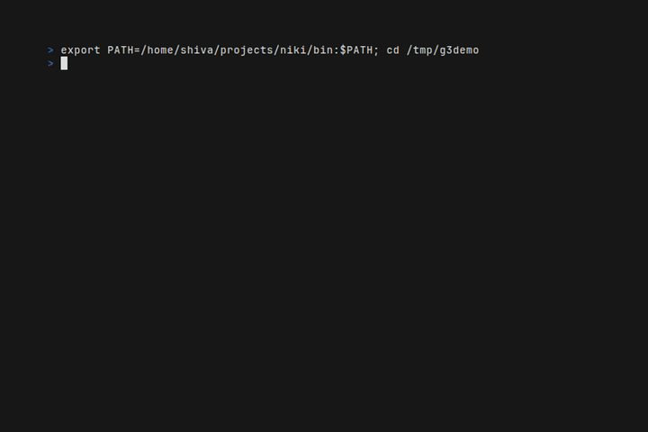

<div align="center">

<table style="border: none"><tr>
<td style="border: none" align="right" valign="middle" width="130"></td>
<td style="border: none" align="left" valign="middle"><pre>
##    # ######  ##    # ######   ######  ###### ####### #######
###   #   ##    ##   #    ##    ##   ## ##   ## ##    # ##     
####  #   ##    ##  #     ##    ##      ##   ## ##    # ##     
## ## #   ##    ####      ##    ##      ##   ## ##    # #####  
##  ###   ##    ##   #    ##    ##   ## ##   ## ##    # ##     
##   ## ######  ##    # ######   ######  ###### ####### #######
</pre></td>
</tr></table>

**NikiCode is an agentic coding tool that lives in your terminal, understands your codebase, and helps you code faster by executing routine tasks, explaining complex code, and handling git workflows — all through natural language commands.**
<!-- claims: C1 C2 C3 C4 C5 C6 -->

[](go.mod)
[](https://github.com/RavaniRoshan/niki/releases)
[](LICENSE)
[](#-performance-no-feelings-just-measurements)
[](#-performance-no-feelings-just-measurements)
[](#-the-workbench)

<br/>

```bash
# Install instantly with Go
go install github.com/RavaniRoshan/niki/cmd/nikicode@latest

# Or download the pre-compiled binary from GitHub Releases
curl -sSL https://raw.githubusercontent.com/RavaniRoshan/niki/main/install.sh | bash
```

[Quick Start](#-quick-start) • [Installation](#-installation) • [Performance](#-performance-no-feelings-just-measurements) • [Security](#-security--sandbox-by-default) • [Architecture](#-the-workbench) • [Documentation](docs/)

</div>

<p align="center">
  
</p>
<p align="center"><sub>Real footage of the actual binary (mock provider) — the agent loop: prompt → thinking → running tool → committed tool cells → streaming reply, twice. Storyboard: <a href="docs/demo-storyboard.md">docs/demo-storyboard.md</a>; reproducible from <a href="docs/demo.tape">docs/demo.tape</a>.</sub></p>

---

## ⚡ Performance: No Feelings, Just Measurements

Measured on the host (`AMD Ryzen 7 4800H`, `Linux WSL2`, `go1.27.1`) with the included PTY probe harness (`tools/ttff`) and `hyperfine 1.20.0`. Every number is real and stored in [`docs/PERF.md`](docs/PERF.md) and [`perf/budgets.toml`](perf/budgets.toml):
<!-- claims: C7 C8 C9 -->

| Tool / Agent | `--version` | TTFP (First Paint) | Input Ready | Idle Memory (2s) | Pre-Prompt Bytes | Binary Size |
| :--- | ---:| ---:| ---:| ---:| ---:| ---:|
| **Codex CLI** (`0.152.1`, Rust) | 20.2 ms | 17.6 ms | 170.7 ms* | 69.3 MB | 88 B | 244 MB |
| **Google agy** (`1.3.1`, Go) | 19.3 ms | 778.5 ms | 778.5 ms | 225.5 MB | 7 B | 202 MB |
| **Kimi Code** (`2.1.1`, TS/Node) | 188.4 ms | 1253.7 ms | 1253.7 ms | 391.6 MB | 7 B | 75 MB |
| **NikiCode** (`0.11.0`, Go) | **6.2 ms** | **5.4 ms** | **16.9 ms** | **16.1 MB** | **12 B** | **19.7 MB** |
| *Contract Budget* | *≤ 20.0 ms* | *≤ 23.4 ms* | *≤ 23.4 ms* | *≤ 40.0 MB* | *minimized* | *< 25 MB* |

> [!NOTE]
> Medians, N=30, same machine (`nikicode bench`, raw in `docs/bench/raw/`). *One reference paints its header at 170.7 ms but sits behind an update modal that blocks input; NikiCode RSS is 9.1 MB with a real home (16.1 MB fresh-home).

> [!TIP]
> **NikiCode**: `--version` in **6.2 ms**, first bytes in **5.4 ms**, input-ready in **16.9 ms**, **16.1 MB** idle RSS, a **19.7 MB** binary. Full method with per-metric caveats: [`docs/BENCH.md`](docs/BENCH.md).

---

## 🖥️ The Workbench

NikiCode's interface is a full-screen, three-rail workbench: the plan and the live agents on the left, the run trace in the centre, the instruments (context, checkpoints, cost) on the right, and Nib — the mascot — as the status indicator. Every visible element is driven by a real event from the engine; when an event has not fired, its element is absent, never faked.

```
┌ header ────────────────────────────────────────────────────────────────┐
│ [Nib] NikiCode  v0.11.0 · <model> · <mode>          <cwd> · <branch>  │
├─ rail ─┬─ run trace ────────────────────────────────────┬─ rail ───────┤
│ PLAN   │ > the request                                   │ CONTEXT     │
│ ✓ 1 …  │   ── step 1 · <label> ───────────────────────  │  <used>/…   │
│ ▶ 2 …  │   ● Read(<file>)   └ <result>                  │ CHECKPOINTS │
│ AGENTS │   ● Edit(<file>)   └ +a −d                     │  ● <label>  │
│ ● <id> │     ┌ diff ──────────────────────────┐          │ COST        │
│        │     │ + …                             │          │  turn <$>   │
│        │     └─────────────────────────────────┘          │  session <$>│
├────────┴──────────────────────────────────────────────────┴─────────────┤
│ > <input>                              mode <mode> · ctrl+k             │
│ [Nib] <state> · <model>        <agents> · <checkpoints> · esc interrupt │
└──────────────────────────────────────────────────────────────────────────┘
```

Inline mode is the other view of the same stream: settled rows commit to your native terminal scrollback and only the live area stays on screen. Both render the same events; the core (`internal/engine`, `internal/protocol`) imports neither.
<!-- claims: C17 -->

---

## 🚀 Quick Start

### 1. Set Your Model API Key
```bash
export ANTHROPIC_API_KEY="sk-ant-..."
# or
export OPENAI_API_KEY="sk-..."
```

### 2. Scaffold Your Project
Initialize your workspace with an `AGENTS.md` instructions hierarchy:
```bash
nikicode init
```

### 3. Verify Health & Environment
Run the built-in doctor command to check sandbox capabilities, provider credentials, and terminal state:
```bash
nikicode doctor
```

### 4. Start Pair Programming
```bash
# Launch the interactive TUI
nikicode

# Or run non-interactive headless tasks
nikicode exec "Audit the repo for open ports and write a summary to ports.md"
```

---

## Why NikiCode?

Most coding agents ship hundreds of megabytes of runtime, take seconds to boot, and consume hundreds of megabytes of RAM just sitting idle. **NikiCode is different.** It was built from the ground up for developers who demand complete ownership, uncompromising speed, and verifiable safety:

* 🚀 **Instant Boot**: boots to an interactive frame in **17 ms warm** and prints `--version` in **6.2 ms**.
<!-- claims: C7 C8 -->
* 🪶 **Featherweight**: **9.1 MB** of idle RSS in a single **19.2 MB** static binary with zero runtime dependencies.
<!-- claims: C9 -->
* 🛡️ **Safe by Default**: sandboxed execution through unprivileged **Bubblewrap** (`bwrap`) with a read-only root, private `/tmp`, network namespace denial, dropped capabilities, and an approval prompt that defaults to **Deny**.
<!-- claims: C17 -->
* 🖥️ **The Workbench**: task-first three-rail layout; every element driven by a real Op/Event, absent until its event fires, truthful instruments (a real value or `—`, never a fabricated number).
<!-- claims: C17 -->
* 🔌 **Unblocked Extensibility**: background parallel MCP startup, mtime-cached skills discovery, and `.agents/skills` compatibility.
<!-- claims: C17 -->
* 🧠 **Multi-Provider Engine**: streaming for Anthropic (Messages API), OpenAI (Responses and ChatCompletions), and local models (Ollama, vLLM) with exponential backoff on 429/5xx and truncated-stream recovery.
<!-- claims: C17 -->
* 💾 **Crash Resilience**: atomic JSONL rollouts allow instant recovery from abrupt mid-turn termination (`kill -9`) with zero lost context.
<!-- claims: C17 -->
* 📂 **Session Browser (`Ctrl+S`)**: dual-pane rollout explorer with fuzzy search, transcript preview, resume, fork, and delete.
* ⚙️ **In-TUI Settings & MCP Wizards (`Ctrl+P`)**: configure models, endpoints, MCP servers, and API keys interactively without manual TOML edits or restarts.
* ✍️ **External `$EDITOR` Bridge (`Ctrl+G`)**: draft multi-line prompts in your system editor via clean terminal raw-mode suspension.
* 🔍 **Floating `@` Mentions & In-Memory Indexer**: real-time autocomplete above the composer with git status badges and zero-dependency symbol resolution.
* 🌿 **Out-of-Band Git Snapshots**: sub-2 ms `git write-tree` snapshots enabling instant rollback (`/rewind`) and redo (`/unrevert`) without clobbering uncommitted work.
* 🤖 **Autonomous Swarms & Worktree Isolation**: hierarchical subagent trees with temporary git worktrees, depth limits, a concurrency semaphore, and budget caps.
* 🚀 **Headless CI Mode**: JSONL event streams and GitHub check-run output via `nikicode exec` / `nikicode ci --check`.
* 🎨 **Split Diff Viewer (`/diff`)**: interactive side-by-side (>120 cols) or unified diff review with keyboard file navigation.

---

## 📦 Installation

### System Requirements
* **Operating Systems**: Linux (x86_64, arm64), macOS (Apple Silicon & Intel). Native Windows is explicitly unsupported — use WSL (see `nikicode doctor`, which labels it).
* **Sandboxing (Linux)**: Bubblewrap (`bwrap`) is recommended for container-grade unprivileged command isolation.
  ```bash
  # Debian/Ubuntu
  sudo apt-get install bubblewrap

  # Fedora / RHEL
  sudo dnf install bubblewrap

  # Arch Linux
  sudo pacman -S bubblewrap
  ```

### Option 1: Pre-built Binaries (GitHub Releases)

Download pre-compiled static binaries from the [Releases](https://github.com/RavaniRoshan/niki/releases) page:

```bash
# Linux (amd64)
curl -L https://github.com/RavaniRoshan/niki/releases/latest/download/nikicode_linux_amd64.tar.gz | tar -xz
sudo mv nikicode /usr/local/bin/nikicode
sudo ln -sf nikicode /usr/local/bin/nc
sudo ln -sf nikicode /usr/local/bin/niki

# macOS (Apple Silicon arm64)
curl -L https://github.com/RavaniRoshan/niki/releases/latest/download/nikicode_darwin_arm64.tar.gz | tar -xz
sudo mv nikicode /usr/local/bin/nikicode
sudo ln -sf nikicode /usr/local/bin/nc
sudo ln -sf nikicode /usr/local/bin/niki

# macOS (Intel amd64)
curl -L https://github.com/RavaniRoshan/niki/releases/latest/download/nikicode_darwin_amd64.tar.gz | tar -xz
sudo mv nikicode /usr/local/bin/nikicode
sudo ln -sf nikicode /usr/local/bin/nc
sudo ln -sf nikicode /usr/local/bin/niki
```

### Option 2: Go Install
If you have Go 1.24+ installed:
```bash
go install github.com/RavaniRoshan/niki/cmd/nikicode@latest
```
Ensure your `$GOPATH/bin` or `$HOME/go/bin` is in your `$PATH`.

### Option 3: Build from Source
Build a static, stripped binary in seconds:
```bash
git clone https://github.com/RavaniRoshan/niki.git
cd niki
go build -ldflags="-s -w" -o bin/nikicode ./cmd/nikicode
make install  # installs nikicode + nc + niki (compat) to ~/.local/bin
```

---

## 🔒 Security & Sandbox by Default

A coding model with arbitrary shell access is an inherent risk. NikiCode implements defense-in-depth from day one:

```
[Untrusted Tool Request]
          │
          ▼
┌───────────────────────────────────────────────┐
│         Permission Approval Guard             │
│  - Safest option (DENY) focused by default    │
│  - Esc key immediately aborts execution       │
│  - Untrusted project configs blocked          │
│  - All decisions logged to audit trail        │
└──────────────────────┬────────────────────────┘
                       │ Approved
                       ▼
┌───────────────────────────────────────────────┐
│     Bubblewrap Sandbox (`nikicode sandbox-run`)   │
│  - Read-only root filesystem (`/`)            │
│  - Isolated private in-memory `/tmp`          │
│  - Network namespace dropped (`--unshare-net`)│
│  - Linux capabilities stripped (`--cap-drop`) │
│  - Bounded strictly to writable workspace     │
└───────────────────────────────────────────────┘
```

* **Default Deny**: interactive permission requests always focus **Deny**. Hitting `Esc` cancels immediately.
* **Red-Team Verified**: proven resistance against exfiltration traps, symlink directory traversal escapes, and hostile package lifecycle scripts. Tested in [`internal/permissions/redteam_test.go`](internal/permissions/redteam_test.go).
* **Project Trust Boundary**: untrusted repositories cannot start MCP servers or execute hooks from a project `nikicode.toml` unless the project path is listed in `~/.nikicode/trusted_projects`.

Read more in [`docs/SECURITY.md`](docs/SECURITY.md).

---

## 🛠️ Built-In Tool Suite

NikiCode ships with a zero-fluff set of native tools — all strictly typed and fail-closed:

| Category | Tools | Capabilities & Safety Guarantees |
| :--- | :--- | :--- |
| **Files & Editing** | `read_file`, `write_file`, `edit_file`, `apply_patch`, `glob`, `grep`, `list_dir` | Bounded line counts, SHA-256 pre-verification, atomic temp swap, fuzzed unified diff parser |
| **Processes & Shell** | `shell`, `exec_command`, `write_stdin`, `bash_output`, `kill_shell` | Bubblewrap sandbox, private `/tmp`, network namespace denial, PTY process trees, PGID signal kill, detach |
| **Navigation & Search** | `symbol_search`, `tool_search` | Zero-dependency AST indexer for Go/Python/TS/Rust, exact/fuzzy tool matching with discovery tracking |
| **Git Workflows** | `git_status`, `git_diff_summary`, `git_smart_commit`, `git_pr_summary`, `git_commit`, `git_branch`, `git_rebase`, `git_log`, `git_blame`, `git_review`, `git_changelog` | Porcelain parsing, staged conventional commits, branch diff summaries, PR generation, conflict-cycle detection |
| **Web & Media** | `web_search`, `web_fetch`, `view_image`, `notebook_edit` | HTTPS upgrade, memory cache, HTML-to-markdown conversion, token-budgeted image downscaling, `.ipynb` JSON edit |
| **Planning & Tasks** | `update_plan`, `todo_write`, `ask_user_question` | Plan mode state machine, session todo ledger, interactive multi-question modal with write-in escape hatch |
| **Autonomous Swarms** | `spawn_agent`, `send_input`, `wait_agent`, `close_agent`, `resume_agent` | Hierarchical subagent trees, git worktree isolation, depth limit, concurrency semaphore, budget caps |

---

## ⌨️ Slash Commands & Terminal Controls

Within the interactive TUI:

| Slash Command | Action |
| :--- | :--- |
| `/palette` | Open fuzzy command palette & interactive settings (`Ctrl+P`) |
| `/sessions` | Open session browser with transcript previews & rollouts (`Ctrl+S`) |
| `/import` | Map a setup from another agent into NikiCode's files (preview first, reversible) |
| `/editor` | Open external `$EDITOR` for multi-line draft editing (`Ctrl+G`) |
| `/export` | Export the session transcript to Markdown or HTML |
| `/diff` | Interactive split-screen side-by-side or unified diff viewer |
| `/plan` | Toggle read-only plan mode exploration (withholds write and exec tools) |
| `/rewind` | Rewind workspace code files or conversation to a previous turn checkpoint |
| `/unrevert` | Redo / restore workspace files from the pre-rewind state |
| `/agents` | Inspect the live subagent list and its status |
| `/explain` | Semantic code explanation with verified file:line citations |
| `/connect` | Guided in-TUI connection for API keys |
| `/cost` | Display session token ledger and accumulated cost |
| `/theme` | Switch color theme (`default`, `dark`, `light`, `monochrome`) |
| `/doctor` | Run comprehensive system, sandbox, and provider health checks |
| `/reload` | Hot-reload configuration without restarting |
| `/compact` | Compact the conversation context |
| `/model` | Inspect or switch active model and context window |
| `/status` | Print the real session state (model, mode, context, cost, counts) |
| `/clear` | Clear the visible transcript |
| `/help` | Display active keybindings, tools, and slash commands |
| `/quit` | Cleanly restore terminal termios state and exit |

### Keyboard Shortcuts

| Shortcut | Description |
| :--- | :--- |
| `Ctrl+P` | Toggle command palette & in-TUI settings (models, MCP wizards, API keys) |
| `Ctrl+S` | Toggle the session browser & rollout explorer |
| `Ctrl+G` | Open prompt draft in external `$EDITOR` |
| `Ctrl+O` | Toggle collapsible tool output and expanded reasoning |
| `Ctrl+B` | Detach active foreground tool execution into background process manager |
| `Ctrl+W` / `Ctrl+U` | Kill text to the Emacs kill-ring (word / line to cursor) |
| `Ctrl+Y` | Yank most recent kill-ring entry at cursor |
| `Ctrl+_` | Undo last edit in composer |
| `Ctrl+C` | Tiered cancel: clears non-empty input; interrupts active turn; double Ctrl+C exits |
| `Ctrl+D` | Exit on empty input; forward-delete character when text is present |
| `Ctrl+Z` | Suspend process cleanly to background via `SIGSTOP` / `SIGCONT` |
| `Esc` | Tiered escape: closes the active overlay; interrupts the active turn |
| `@` | Triggers the floating symbol & file mention autocomplete overlay |
| `/` | Triggers the fuzzy slash command suggestions dropdown |
| `Tab` / `Enter` | Autocomplete the selected mention or slash command; submit prompt |

---

## ⚙️ Configuration & Profiles

NikiCode merges layers (later wins): `Defaults` → global `~/.config/nikicode/nikicode.toml` → profile → project `nikicode.toml` → `--config` file → environment → CLI flags. Legacy `niki` spellings are honored; see `CONFIG.md`.

Inspect your effective configuration and see exactly where each setting originates:
```bash
nikicode config show --sources
```

Example configuration (global `~/.config/nikicode/nikicode.toml`):
```toml
# Model settings
model = "claude-3-5-sonnet"
provider = "anthropic"

# Performance
disable_preconnect = false        # set true (or NIKICODE_NO_PRECONNECT=1) to skip the background DNS warm

# Sandbox & Safety
sandbox_backend = "bubblewrap"
deny_network = true
writable_roots = ["."]
trusted_projects = ["/home/user/projects/trusted"]

# Profiles
[profiles.fast]
model = "gpt-4o-mini"
provider = "openai"

# Model Context Protocol (MCP)
[mcp.filesystem]
command = "npx"
args = ["-y", "@modelcontextprotocol/server-filesystem", "."]
required = false
startup_timeout_sec = 10
tool_timeout_sec = 30
```

Read the full configuration guide in [`CONFIG.md`](CONFIG.md).

---

## 📖 Deep-Dive Documentation

* 📐 [Architecture & Dependency Graph](docs/ARCHITECTURE.md) — package DAG, acyclic invariants, design principles.
* 🖥️ [Workbench Spec](docs/tui/WORKBENCH.md) — the layout, the wiring table, the audit.
* ⚙️ [Configuration](CONFIG.md) — layers, profiles, project trust, environment.
* 🛠️ Routines: [`nikicode do`](docs/CLAIMS.md) (recipes in `internal/recipes/*.md`), [git workflows](docs/CLAIMS.md) (`nikicode git`), [code explanations](docs/CLAIMS.md).
* 🤖 Subagents, plan mode, memory, MCP, providers: [capability parity](docs/PARITY.md), [feature atlas](docs/FEATURE_ATLAS.md).
* ⚡ [Performance Ledger](docs/PERF.md) — inittrace audit, pprof analysis, runtime traces, PGO benchstat data.
* 🏁 [Benchmark Method & Table](docs/BENCH.md) — the `nikicode bench` protocol, raw logs, per-metric verdicts.
* 🛡️ [Security Posture](docs/SECURITY.md) — the sandbox model, trust boundaries, red-team defenses.
* 📜 [Third-Party & Attributions](THIRD_PARTY.md) — dependency licenses, attributions, clean-room provenance.
* 🐶 [Dogfooding Journal](docs/DOGFOOD.md) — real self-hosting sessions and ergonomic friction logs.
* ✅ [Claims Ledger](docs/CLAIMS.md) — every user-facing claim with its proving probe.
* 🏁 [Final Verdict](docs/VERDICT.md) — positioning trace, speed verdict, what was not built.

---

## 📦 Packaging & CI/CD

NikiCode builds as a completely self-contained static binary with zero CGO dependencies (`CGO_ENABLED=0`):

* **Local Installation**: `make install` builds stripped binaries (`-trimpath -ldflags="-s -w"`) and links `nikicode`, `nc`, and `niki` into `~/.local/bin/`.
* **CI** ([`.github/workflows/ci.yml`](.github/workflows/ci.yml)) runs on every pull request and push to `main` across Linux and macOS:
  - Compiler hygiene (`go vet ./...`) and lint (`golangci-lint run ./...`).
  - TUI purity enforcement ([`internal/lintcheck`](internal/lintcheck/)): zero I/O on render paths, zero color literals outside `theme.go`.
  - Race detection across the packages, PTY end-to-end smoke tests, and native Go fuzzing.
* **Releases** ([`.github/workflows/release.yml`](.github/workflows/release.yml)): stripped static binaries with SHA-256 checksums for `linux/amd64`, `linux/arm64`, `darwin/amd64`, `darwin/arm64`, `windows/amd64`.

---

## Philosophy

1. **Rule of Proof**: "works" means a real test or measurement ran and its output was verified.
2. **Zero Proprietary Code**: no leaked, decompiled, or reconstructed proprietary source was ever accessed or copied.
3. **Small and Boring**: dependencies pass strict admission checks; zero framework sprawl.
